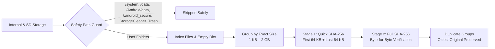
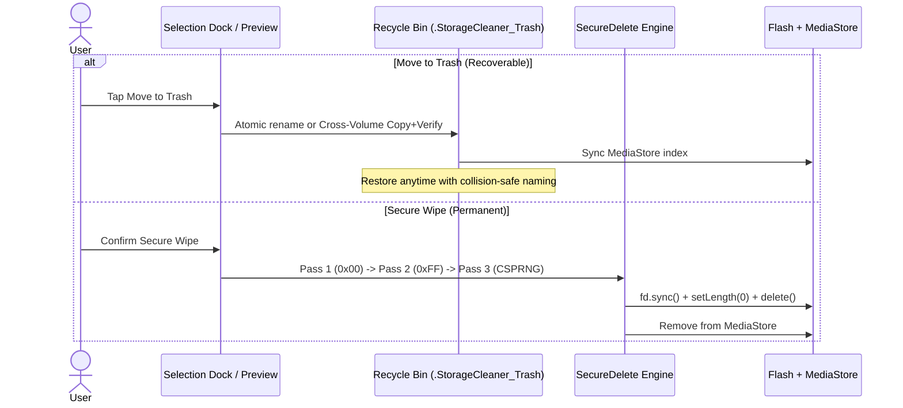

<div align="center">



<br/>

[](https://github.com/Niranjan-Kumar-Singh/storage-cleaner-android/actions/workflows/build.yml)
[](https://github.com/Niranjan-Kumar-Singh/storage-cleaner-android/releases/latest)
-10B981?style=for-the-badge&logo=android&logoColor=white)

[](LICENSE)

</div>

---

## Why Storage Cleaner?

Most Android cleaner apps rely on dark-pattern "RAM boost" animations, background ad SDKs, and shallow `File.delete()` calls that leave deleted data recoverable on flash storage. **Storage Cleaner** is engineered from the ground up with:

- **Zero Telemetry & Zero Ads** — runs strictly on-device (`INTERNET` is used *only* when you manually tap **Check for Updates**).
- **Exact Duplicate Engine** — two-stage SHA-256 verification catches byte-identical copies with zero false positives.
- **Forensic-Grade Wipe** — overwrites sensitive files using DoD 5220.22-M 3-pass scrubbing before unlinking.
- **Inspect Before You Delete** — EXIF-aware image preview, live video thumbnails, audio tags, and monospace text/log preview right inside the app.

---

## Architecture & Pipelines

### 1. DoD 5220.22-M 3-Pass Wipe Pipeline

<div align="center">
  
</div>

### 2. Multi-Stage Duplicate & Safety Pipeline



### 3. Soft-Delete vs. Permanent Erasure



---

## Key Capabilities

<table>
<tr>
<td width="50%" valign="top">

### Smart Storage Analysis
- **Multi-Volume Indexer**: Scans internal storage and external SD cards with live progress & instant scan cancellation.
- **16 Category Pills**: `Folders`, `All files`, `Large (50MB+)`, `Duplicates`, `Images`, `Videos`, `Audio`, `Docs`, `Archives`, `APKs`, `Downloads`, `Screenshots`, `Chat media`, `Junk files`, `Old files`, and `Empty folders`.
- **Quick Clean Highlights**: Surfaces safe wins (junk caches, duplicate copies, residual APKs, empty folders) right below the hero storage meter.
- **Animated Storage Donut**: Breakdown across all 7 file types directly inside the collapsible dashboard card.

</td>
<td width="50%" valign="top">

### Previews, Apps & Updates
- **EXIF & Video Thumbnails**: Properly rotated JPEG previews, live MP4/MKV thumbnail frames, and scrollable text previews for `.txt`, `.log`, `.json`, `.xml`, and `.csv`.
- **Duplicate Compare Sheet**: Compares all copies (`2+` identical files), lets you preview any copy on tap, or wipe all redundant copies keeping the oldest original.
- **App Manager**: Displays native launcher icons + APK sizes for installed user & system apps with one-tap deep links to System Cache settings.
- **Built-In Update Checker**: Queries GitHub Releases (`api.github.com`) only on demand and compares SemVer tags or CI build commits.

</td>
</tr>
</table>

---

## Adaptive Design Tokens

Built for WCAG AA+ readability with dynamic status & navigation bar synchronization:

| Token | Midnight Obsidian (Dark) | Crisp Porcelain (Light) | Role |
| :--- | :--- | :--- | :--- |
| **Canvas** | `#090C12` | `#F4F6FA` | Main OLED / Porcelain backdrop |
| **Card Surface** | `#161D2D` | `#FFFFFF` | Elevated bento containers & sheets |
| **Primary Action** | `#4263EB` | `#3653C9` | High-contrast Cobalt CTA fills |
| **Teal Accent** | `#2DD4BF` | `#0F766E` | Storage progress & highlights |
| **Destructive** | `#E11D48` | `#DC2626` | Secure Wipe & empty-bin actions |

---

<details>
<summary><b>Permissions & Security Model</b> (click to expand)</summary>

| Permission | Justification |
| :--- | :--- |
| `MANAGE_EXTERNAL_STORAGE` | Required on Android 11+ to index folders, inspect junk/caches, and move or wipe files. |
| `READ_MEDIA_IMAGES/VIDEO/AUDIO` | Reads media dimensions, EXIF tags, and thumbnails on Android 13+. |
| `QUERY_ALL_PACKAGES` | Populates installed applications with real icons and APK sizes in App Manager. |
| `POST_NOTIFICATIONS` / `RECEIVE_BOOT_COMPLETED` | Optional user-scheduled cleanup reminders (7 / 14 / 30 days) that persist across device reboots. |
| `INTERNET` | Triggered **exclusively** when manually tapping **Check for Updates**. No background connections or analytics SDKs. |
| `android:allowBackup="false"` | Prevents cloud backup extraction of local Recycle Bin metadata. |

</details>

<details>
<summary><b>Project Source Layout</b> (click to expand)</summary>

```text
app/src/main/java/com/example/storagecleaner/
├── MainActivity.kt              # Root state, dynamic system bars, dashboard & file browser
├── data/
│   ├── FileModels.kt            # File kinds, tag bitmasks, protected OS path constants
│   ├── Scanner.kt               # Cancellable storage walker, 2-stage SHA-256 finder, lexical path guard
│   ├── RecycleBin.kt            # Cross-volume soft delete, collision-safe restore & MediaStore sync
│   ├── ReminderManager.kt       # Notification alarm manager + reboot reschedule receiver
│   └── UpdateChecker.kt         # Zero-dependency JSON parser & GitHub Releases checker
├── security/
│   └── SecureDelete.kt          # DoD 5220.22-M 3-pass overwrite + truncation engine
└── ui/
    ├── Theme.kt                 # Obsidian/Porcelain palettes, non-clipping buttons, shared search bar
    ├── AppDrawer.kt             # Navigation drawer, appearance switcher, About & Update triggers
    ├── FilePreviewDialog.kt     # EXIF photo, video frame, audio & monospace text/log preview dialog
    ├── FileThumbnail.kt         # Image + video frame thumbnails with adaptive category icons
    ├── DuplicateCompareSheet.kt # Multi-copy duplicate sheet with tap-to-preview
    ├── RecycleBinScreen.kt      # Recoverable trash view with restore and permanent purge
    ├── AppCacheScreen.kt        # Installed app browser with native icons and APK sizes
    ├── StoragePieChart.kt       # Animated category distribution donut chart
    └── UpdateDialog.kt          # Interactive GitHub Release check & APK download modal
```

</details>

<details>
<summary><b>Local Build, Tests & Automated CI/CD</b> (click to expand)</summary>

```bash
git clone https://github.com/Niranjan-Kumar-Singh/storage-cleaner-android.git
cd storage-cleaner-android

# Run the 15-test JUnit verification suite
gradle testDebugUnitTest

# Build Debug & Release APKs
gradle assembleDebug assembleRelease
```

Every push to `main` executes [`.github/workflows/build.yml`](.github/workflows/build.yml) (JDK 17 + Gradle 8.7), runs `testDebugUnitTest`, compiles both APKs, and publishes assets to the [`latest` release](https://github.com/Niranjan-Kumar-Singh/storage-cleaner-android/releases/latest).  
Optional GitHub Actions secrets for custom release signing: `KEYSTORE_BASE64`, `RELEASE_STORE_PASSWORD`, `RELEASE_KEY_ALIAS`, and `RELEASE_KEY_PASSWORD`.

</details>

---

<div align="center">

Built by **Niranjan Kumar Singh** · Licensed under the [MIT License](LICENSE)

</div>
